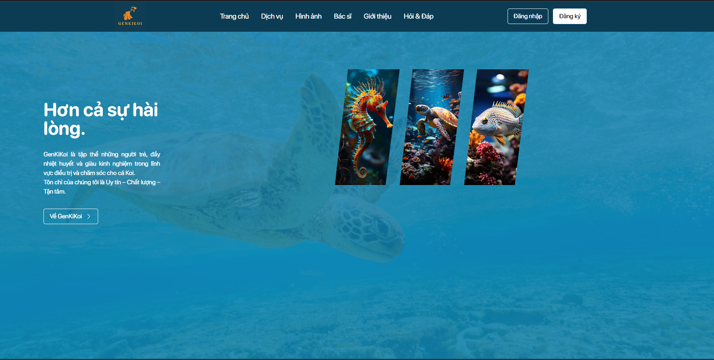

# minthep-portfolio

Portfolio và blog học tập của **Mai Tấn Thép**.
Static HTML · GitHub Pages · không có build step.

**Live:** <https://thepkz.github.io/minthep-portfolio/>

---

## ⚠️ ĐỌC TRƯỚC KHI SỬA BẤT CỨ THỨ GÌ — READ THIS FIRST

### 1. KHÔNG BAO GIỜ tạo file `CNAME`. NEVER add a `CNAME` file.

This site is a GitHub Pages **project page**. Its base path is:

```
https://thepkz.github.io/minthep-portfolio/
        └── origin ──────┘└─ base path ──┘
```

Adding a `CNAME` file (for `minthep.com` or anything else) rewrites the base
path from `/minthep-portfolio/` to `/`. The moment that happens:

* every one of the ~223 URLs Google currently has indexed returns **404**,
* every `<loc>` in `sitemap.xml` returns **404**,
* every backlink to a study PDF returns **404**,
* and the 12,374-word statistics article — the single highest-value page on
  the site — drops out of search.

There is no gradual failure mode here. It is instant and total.
`tools/check-routes.mjs` (check E) **fails the build** if a `CNAME` file
appears at the repo root. That check is not a suggestion; do not delete it.

If the owner genuinely wants `minthep.com`, the correct migration is: publish
the new domain, serve 301 redirects **from** the old paths **to** the new ones
at the HTTP layer, and keep this repo's URLs resolving. GitHub Pages cannot do
that. Plan it properly or do not do it.

### 2. Never use a root-absolute path.

```html
<!-- ✗ resolves to https://thepkz.github.io/css/tokens.css → 404 -->
<link rel="stylesheet" href="/css/tokens.css">

<!-- ✓ -->
<link rel="stylesheet" href="css/tokens.css">
<link rel="stylesheet" href="../css/tokens.css">   <!-- from blog/ or wy/ -->
```

Same rule for `src`, `url()` in CSS (resolved relative to the *CSS file*, not
the HTML), `import` in ES modules, `fetch()`, and any path a script builds at
runtime.

Fully-qualified `https://thepkz.github.io/minthep-portfolio/…` URLs are allowed
in exactly five places, and nowhere else:

| Where | Why |
|---|---|
| `<link rel="canonical">` | must be absolute by spec |
| `og:url`, `og:image` | scrapers do not resolve relative URLs |
| JSON-LD `@id` / `url` / `image` | same |
| `sitemap.xml` | `<loc>` must be absolute by spec |
| **`404.html` only** | see below — this one page is a deliberate exception |

`tools/check-routes.mjs` (check C) fails the build on any root-absolute path.

### 3. Nothing is ever deleted.

The route-preservation contract (below) is the hardest constraint in this repo.
Superseded files stay on disk and simply stop being referenced — an
unreferenced file costs a visitor nothing because it is never downloaded, but a
deleted file is an unrecoverable 404 in Google's index.

**No `rm`. No `mv`. No renames.** A rename is a delete plus a create.

---

## Architecture

### No build step — this is the whole deployment

`.github/workflows/static.yml` uploads the repository root (`path: '.'`)
verbatim to GitHub Pages on every push to `main`. There is no compile, no
bundle, no transform, no npm install, no `node_modules`. **What is committed is
what is served, byte for byte.**

Everything therefore has to run as a plain static file:

* vanilla ES modules loaded with `<script type="module">`
* plain CSS with custom properties — no SCSS, no PostCSS
* no JSX, no TypeScript
* third-party libraries are **self-hosted** under `vendor/`, not CDN-loaded
* `.nojekyll` at the repo root stops Jekyll from touching anything, in case the
  deploy method is ever changed to a Jekyll build

The scripts in `tools/` are **not** part of the deploy. They are run once, by a
human, on a laptop, and their output is committed. See "Regenerating assets".

### Three surfaces, one shared token layer

Every page loads the same four stylesheets in the same fixed order:

```
css/tokens.css  →  css/base.css  →  css/components.css  →  css/surface-{a|b|c}.css
```

* **`tokens.css`** — custom properties **only**. Colour ramps, type scale,
  spacing, radii, durations, easings, z-index layers. The only selectors
  permitted in the file are `:root` and `[data-reading="paper"]`.
* **`base.css`** — reset, the `@font-face` blocks, global type rules, focus
  ring, `prefers-reduced-motion` handling.
* **`components.css`** — the shared component layer. Its public API is
  data-attributes (`[data-nav]`, `[data-reveal]`, `[data-eyebrow]`,
  `[data-footer]`, `[data-icon]`, `.btn[data-variant]`…), so no surface file
  ever has to know a class name.
* **`surface-*.css`** — only what is specific to that surface.

**The hard rule for surface files:** no colour, size, radius, duration or
z-index *literal*. Everything is `var()` or `calc()` over a token.
`tools/check-routes.mjs` (check G) greps for `#rrggbb`, bare `px` and bare
`z-index:` in the surface sheets and fails the build.

| Surface | Pages | Sheet | Script |
|---|---|---|---|
| **A** — landing | `index.html`, `404.html` | `surface-a.css` | `js/core.js` |
| **B** — study blog | `blog/*.html`, `test_html/vc.html` | `surface-b.css` | `js/core.js` + `js/surface-b.js` |
| **C** — `wy/` | `wy/*.html` | `surface-c.css` | `js/core.js` + `js/surface-c.js` + `vendor/gsap/` |

`js/core.js` is shared by all 17 pages and owns nav, drawer, scroll reveal and
the `[data-anim]` IntersectionObserver gate. GSAP is loaded on Surface C and
nowhere else.

### Progressive enhancement is mandatory

If JavaScript never runs, every page is still fully readable. No element is
left at `opacity: 0` by static CSS — reveal initial states are scoped under
`html.js`, which `core.js` sets. `html.no-js` renders a complete page.

Every infinite animation starts `animation-play-state: paused` and is released
by the `[data-anim]` observer only when it is on screen. Everything collapses
under `prefers-reduced-motion: reduce`.

### Repository layout

```
minthep-portfolio/
├── index.html                  Surface A landing page
├── 404.html                    Vietnamese not-found page (SEE THE WARNING BELOW)
├── robots.txt                  advisory only on a project page — read the file
├── sitemap.xml                 27 URLs, absolute, lastmod from git
├── manifest.webmanifest        PWA basics, theme-color #0D0B0B
├── .nojekyll                   empty; disables Jekyll processing
├── css/                        tokens · base · components · surface-a/b/c · lqip
├── js/                         core.js · surface-b.js · surface-c.js
├── fonts/                      self-hosted woff2 slices (see fonts/README.md)
├── vendor/gsap/                self-hosted GSAP (Surface C only)
├── img/                        site imagery + sprite.svg + favicons
├── blog/                       Surface B: 10 HTML pages + assets + PDFs
├── downloadfile/               7 study PDFs + nguphap.rar/.zip
├── test_html/                  vc.html — Three.js 360° viewer
├── wy/                         Surface C
├── tools/                      LOCAL scripts — not a build step
├── docs/                       DOWNLOADS.md — payload notes and known risks
└── .github/workflows/
    ├── static.yml              the deploy. Do not break this.
    ├── verify.yml              runs tools/check-routes.mjs on every push/PR
    └── jekyll-docker.yml       inert legacy; kept on disk, harmless
```

---

## The route-preservation contract

**Every URL that resolves today must keep resolving, at the same path, with
equivalent-or-better content. Forever.**

This is not perfectionism. The owner has real organic search traffic, and it is
concentrated in a small number of long, genuinely useful documents:

* `blog/textblog-3.html` — 12,374 words of MAS291 (Xác suất Thống kê)
* `blog/textblog-5.html` — 8,427 words of SWE201c / PE / FE material
* `blog/textblog-1.html` — 3,320 words of JPD113 grammar and counters
* the 10 study PDFs, which are linked to from outside the site

Google will drop a 404 from its index and will not restore it when the URL
comes back. There is no undo. So:

1. **Pages are upgraded in place**, at their existing path. Never moved,
   never renamed, never redirected away.
2. **Case is preserved exactly.** GitHub Pages runs on a case-sensitive
   filesystem; macOS APFS does not. `wy/Door.html` and `blog/Speaking.html`
   have capitals and must keep them. Two images were 404ing in production for
   months purely because of this, and looked fine on every developer machine.
3. **New "pretty" URLs may be added** (`blog/index.html` → `blog/myblog.html`),
   but never at the cost of an old one. A superseded page keeps serving real
   content and points at its replacement with `<link rel="canonical">` — never
   a bare redirect that throws the content away.
4. **`blog/myblog.html` is load-bearing.** It is the only inbound link to
   textblog-2/3/4/5. Break it and four high-value pages orphan at once.

`tools/routes-frozen.json` is the frozen manifest of every protected route.
`tools/check-routes.mjs` asserts them all, plus case-exact resolution of every
local `href`/`src`, on every push. It is wired up in
`.github/workflows/verify.yml`.

```bash
node tools/check-routes.mjs           # all checks
node tools/check-routes.mjs --quiet   # summary table only
```

---

## 404.html — why it breaks the relative-path rule on purpose

`404.html` at the repo root **is** honoured by GitHub Pages for everything under
`/minthep-portfolio/`. But it is served *in place* — the browser's URL bar still
shows the address that failed, and that address can be at any depth:

```
/minthep-portfolio/blog/typo.html      → 404.html served, base = /minthep-portfolio/blog/
/minthep-portfolio/a/b/c/d/nope.html   → 404.html served, base = /minthep-portfolio/a/b/c/d/
```

A relative `href="css/tokens.css"` in that document resolves against the
*failed* URL, not against the repo root, so it 404s too — and the 404 page
renders unstyled. This is the one and only file in the repo where every asset
reference and every recovery link is a fully-qualified
`https://thepkz.github.io/minthep-portfolio/…` URL. That is deliberate and it
is documented inside the file. **Do not "fix" it to use relative paths.**

---

## Regenerating assets

None of this runs at deploy time. Run it locally, inspect the diff, commit the
output.

### Fonts — `tools/subset-fonts.sh`

```bash
bash tools/subset-fonts.sh
```

Downloads the `latin`, `latin-ext` and `vietnamese` woff2 slices for Anton,
Be Vietnam Pro and Newsreader straight from the Google Fonts CSS2 API (with a
modern Chrome User-Agent — an old or absent UA gets you `ttf`/`woff` instead of
`woff2`), writes them into `fonts/`, and prints the matching `@font-face`
blocks with the exact `unicode-range` values.

`pyftsubset` is **not** used and is not installed. Google already serves
per-subset, pre-subsetted files, and keeping them separate is strictly better
here: a visitor on an ASCII-only page never downloads the Vietnamese slice at
all. The Vietnamese slices are non-negotiable — the entire site is in
Vietnamese and the diacritics live in that range.

Sanity check after running: every file must start with the `wOF2` magic.

```bash
for f in fonts/*.woff2; do printf '%s %s\n' "$(head -c4 "$f")" "$f"; done
```

### Images — `tools/optimize-images.sh`

```bash
bash tools/optimize-images.sh
```

Writes AVIF + WebP **siblings** next to every original at per-surface widths.
Originals are never touched, never renamed, never removed — an original path is
a hot-linkable URL. Consumed as:

```html
<picture>
  <source srcset="img/project4.avif" type="image/avif">
  <source srcset="img/project4.webp" type="image/webp">
  
</picture>
```

It also fixes the two GitHub Pages case bugs (`Histogram.webp`,
`Scrum-model.webp`) by **copying** to the lowercase name so that both spellings
resolve, and publishes `tools/asset-manifest.json`, which is the contract every
HTML page reads for dimensions.

Requires ImageMagick 7 (`magick`) and `cwebp`. `avifenc` and `ffmpeg` are not
installed on the authoring machine; the script degrades accordingly.

### Blur-up placeholders — `tools/gen-lqip.sh`

```bash
bash tools/gen-lqip.sh . > css/lqip.css
```

Emits, per image slot, a 20px-wide WebP inlined as a `data:` URI plus the
image's dominant colour, as custom properties on `:root`. Small enough to sit
in critical CSS with no extra request. Called automatically by
`optimize-images.sh`.

### Regenerating `sitemap.xml`

`sitemap.xml` carries a real `<lastmod>` per URL, taken from git rather than
from a build clock — a fabricated `lastmod` trains crawlers to ignore the field
entirely. To refresh one entry after a content change:

```bash
git log -1 --format=%cI -- blog/textblog-3.html
```

…and paste that value into the URL's `<lastmod>`. The file lists **17 HTML
routes + 10 PDFs = 27 URLs**. Two filenames in `blog/textblog-3/` are hostile
and must stay percent-encoded in the sitemap and never renamed on disk:

| On disk | In sitemap |
|---|---|
| `Exercise Book MAS291  2021.pdf` (**double** space) | `Exercise%20Book%20MAS291%20%202021.pdf` |
| `Montgomery_Runger…Engineers,_5th.pdf` (comma) | `…Engineers%2C_5th.pdf` |

Verify every `<loc>` still corresponds to a file that exists:

```bash
python3 - <<'PY'
import re, urllib.parse, pathlib
BASE = "https://thepkz.github.io/minthep-portfolio/"
bad = 0
for loc in re.findall(r"<loc>(.*?)</loc>", pathlib.Path("sitemap.xml").read_text()):
    rel = urllib.parse.unquote(loc[len(BASE):]) or "index.html"
    if not pathlib.Path(rel).is_file():
        print("MISSING:", rel); bad += 1
print("FAIL" if bad else "OK — every <loc> resolves to a real file")
PY
```

---

## Local preview

Any static server works; you only need one that serves the directory as-is.

```bash
python3 -m http.server 8080
# → http://localhost:8080/
```

Note that this serves the repo at `/`, not at `/minthep-portfolio/`, so it will
happily resolve a root-absolute path that is broken in production. Trust
`tools/check-routes.mjs`, not the local server.

macOS is case-insensitive and will also happily serve `histogram.webp` when the
file on disk is `Histogram.webp`. Production will not. Again: trust the checker.

---

## Contact

Takedown or correction requests: [GitHub Issues](https://github.com/thepKz/minthep-portfolio/issues) (48-hour response
commitment; see `wy/CREDITS.md`). No email address is published anywhere on the
site — the issue tracker is the single, auditable contact channel.

## Giấy phép

Trường cho nên không cần :>
